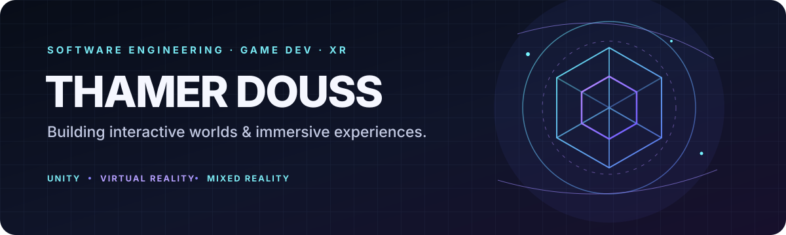
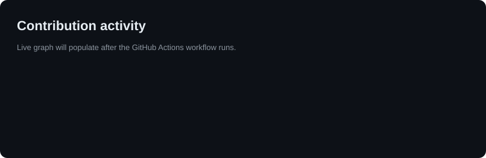

<p align="center">
  
</p>

<p align="center">
  <b>I build worlds you can step into.</b><br/>
  <sub>Game &amp; XR developer &nbsp;·&nbsp; 2× Game Jam Champion (2026) &nbsp;·&nbsp; Tunis</sub>
</p>

<p align="center">
  <a href="https://portfolio-thamer-douss.vercel.app"><b>Portfolio</b></a> &nbsp;·&nbsp;
  <a href="https://portfolio-thamer-douss.vercel.app/cv.pdf">CV</a> &nbsp;·&nbsp;
  <a href="mailto:thamer.douss+stage@gmail.com">Email</a>
</p>

<p align="center">
  <picture>
    <source media="(prefers-color-scheme: dark)" srcset="assets/contrib-dark.svg">
    <source media="(prefers-color-scheme: light)" srcset="assets/contrib-light.svg">
    
  </picture>
</p>

### Player card

| Player | xAgesx |
|---|---|
| **Class** | Gameplay engineer, with a soft spot for VR |
| **Main** | Unity · C# · XR Interaction (Meta Quest 3) |
| **Side quests** | Three.js · Angular · Firebase · Java |
| **Achievements** | 🏆 EPI VR Game Jam 2026 · 🏆 Global GameJam 2026 |
| **Status** | 🟢 Open to internships, freelance and full-time |

I like the moment a system clicks and a world starts to feel alive: AI that behaves, physics that feels right, a space you want to look around in. I prototype fast, then spend the rest of the time on feel.

### Selected work

| Project | Stack | |
|---|---|---|
| [**VR-GameJam**](https://github.com/xAgesx/VR-GameJam) | Unity · C# | 🏆 1st, EPI VR Game Jam 2026. Split-screen co-op game |
| [**Global GameJam 2026**](https://github.com/xAgesx/GlobalGameJam-Entry---Unity) | Unity · C# | 🏆 1st, Spatial Mechanics. 48-hour puzzle game |
| [**Aethera**](https://github.com/xAgesx/Aethera-Angular-Three) | Angular · Three.js · Firebase | Immersive web experience with auth and real-time data |
| [**SliceMania**](https://github.com/xAgesx/SliceMania-Unity-2D) | Unity 2D · C# · AdMob | Mobile arcade game with the new Input System |
| [**First VR**](https://github.com/xAgesx/First_VR_Game-Unity) | Unity · XR Origin | Atmospheric VR puzzle |
| [**Vanilla Java Engine**](https://github.com/xAgesx/MyFirstGame-Java-) | Java | A game with no engine: physics and render loop from scratch |

<sub>Private work: a taxi simulation (AI traffic, procedural city, day/night cycle) and a Meta Quest 3 fire-training MR app.</sub>

### Patch notes

```diff
+ 2026  Won the Global GameJam: Spatial Mechanics, 48 hours, one puzzle game
+ 2026  Won the EPI VR Game Jam: co-op Excellence, split-screen, cozy world
+ Jul   Joined SIV Games (Tunis): shipped a full taxi sim with AI traffic and a procedural city
+ Jun   Freelance: Meta Quest 3 fire-training MR app with hand tracking
+ Sep   Armageddon Studios: first remote engineering internship (2025)
- bugs  Still hunting them
```

<p align="center"><sub><b>Currently:</b> looking for the next team to build with. <a href="mailto:thamer.douss+stage@gmail.com">Say hi →</a></sub></p>
